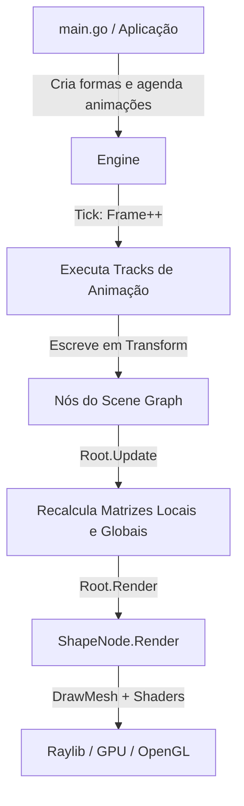

# Arquitetura do MotionGo

Este documento descreve a divisão de responsabilidades, padrões de design e estrutura dos pacotes do projeto MotionGo.

---

## 1. Visão Geral dos Módulos

```text
MotionGo/
├── internal/
│   └── core/          # Grafo de cena, nós e transformações espaciais puras
├── pkg/
│   └── anim/          # Engine de animação, builders, formas e iluminação (API pública)
├── assets/
│   ├── shaders/       # Arquivos GLSL (Vertex e Fragment Shaders)
│   └── assets.go      # Embed FS (go:embed) para compilar recursos no binário
└── main.go            # Exemplo de entrada e demonstrações da biblioteca
```

---

## 2. Divisão de Responsabilidades

### `internal/core` (Núcleo do Grafo de Cena)
O pacote `core` é estritamente interno e focado na estrutura de dados do grafo de cena e na álgebra linear:
- **`Node` (Interface)**: Contrato base para qualquer elemento que ocupe o espaço 3D na cena e participe do cálculo de matrizes.
- **`BaseNode`**: Implementação concreta contendo a árvore de filhos (`Children`), matriz local (`LocalMatrix`) e matriz global combinada (`GlobalMatrix`).
- **`Transform`**: Estrutura com posição (`Vector3`), rotação em quatérnion (`Quaternion`) e escala (`Vector3`).
- **Composição de Matrizes (TRS)**: Multiplicação das matrizes de Translação, Rotação e Escala, propagando as matrizes de nós pais para filhos durante o método `Update()`.

### `pkg/anim` (Camada Pública da Biblioteca)
É o ponto de entrada principal para usuários da biblioteca:
- **`Engine`**: Orquestrador que gerencia o loop de desenho Raylib, o avanço da contagem de frames (`Tick`) e a raiz da cena (`Root`).
- **`Builder[T]` & Builders Específicos (`MoveBuilder`, `RotateBuilder`, `ScaleBuilder`)**: Interface fluente para agendamento declarativo de animações.
- **`Track[T]` & `Interpolator[T]`**: Estruturas de dados responsáveis por armazenar o intervalo de frames e aplicar a interpolação em valores pontuais.
- **`ShapeNode` e Primitivas**: Wrappers que unem um `*core.BaseNode` a malhas (`rl.Mesh`), materiais (`rl.Material`) e cores Raylib.
- **`Light` e Sistema de Shaders**: Carregamento de shaders da GPU e gerenciamento de iluminação difusa/especular e pós-processamento.

### `assets` (Recursos Estáticos Embutidos)
Utiliza a funcionalidade padrão do Go (`//go:embed shaders/*`) para empacotar os arquivos GLSL diretamente no binário final compilado, eliminando dependências de arquivos soltos em disco no runtime.

---

## 3. Fluxo de Dados e Pipeline de Renderização


